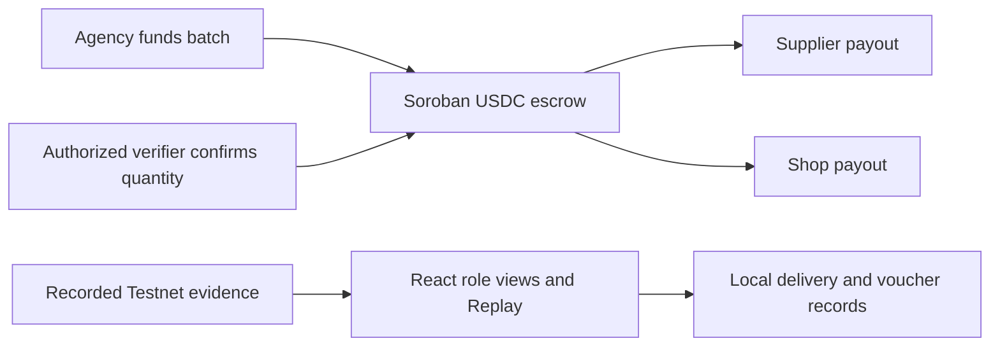

# Stellar Relief

**Pre-funded Relief Supply with Offline Voucher Distribution**

## Project Overview

Stellar Relief is a humanitarian logistics prototype. An aid agency secures relief funds in a Stellar escrow before a supplier ships goods. The supplier can verify the committed funds. Families collect goods at a local shop using offline vouchers, and an authorized verifier can release the supplier payment and shop fee in a single USDC settlement.

## The Problem

Local suppliers can face delays between accepting a relief order and getting paid. The uncertainty can hold up shipments, while unreliable connectivity can interrupt voucher distribution and reconciliation.

## Our Solution

The agency funds the batch upfront and records who is authorized to verify it. A supplier can inspect the deposit before shipping. The shop can record aid collection during an outage and reconcile its records after reconnecting. The current contract enforces the payment terms. The browser demo illustrates the field operations.

## How It Works

1. The agency funds a batch and registers the supplier, shop, verifier, and payout amounts.
2. The supplier verifies the escrow and records a batch delivery in the demo. The shop independently enters and confirms the received quantity.
3. The shop records voucher redemptions up to the confirmed quantity, including offline after the production app is cached. After reconnecting, it can mark records reconciled locally.
4. The authorized verifier submits the quantity. Soroban atomically pays the supplier and shop and marks the batch settled.

For a 100 USDC relief batch, the intended split is 70 USDC for the supplier and 30 USDC for the shop. The recorded Testnet run used **10 USDC → 7 USDC + 3 USDC**.

## Why Stellar & Soroban?

Stellar gives agencies and suppliers a shared transaction record they can inspect independently. Soroban lets the contract enforce authorization and batch state and commit both payouts together. The Testnet run used USDC through its Stellar Asset Contract.

## Key Features

- USDC escrow with agency funding authorization, verifier-only settlement, quantity validation, and duplicate-settlement protection.
- Agency, Supplier, Local Shop, and Verification views.
- Separate supplier and shop actions with a batch-scoped audit timeline and redemption count.
- Three local paper vouchers with offline entry, reload persistence, duplicate rejection, and simulated reconciliation.
- Read-only Testnet lookup that compares live contract state with the recorded run.
- Historical Replay of the verified batch, with field operations labeled as simulations.

## System Architecture



The Python E2E runner manages Testnet transactions and checkpoints separately from the web app. The frontend reads a checked-in evidence snapshot and stores the delivery and voucher demo on the current browser.

## Demo Screenshots

Screenshots are pending visual browser verification. Run the demo locally to explore the four role views.

## Stellar Testnet Deployment

| Field | Recorded value |
| --- | --- |
| Network | Stellar Testnet |
| Run ID | `f141f179b1d94e349421b48e0bfbafe6` |
| Contract | [`CCOZA3KQNXIYB3ERKKAYZ4NKWBHTZQFSIEQQS7HXEBGH3RULUXHJ7PMR`](https://stellar.expert/explorer/testnet/contract/CCOZA3KQNXIYB3ERKKAYZ4NKWBHTZQFSIEQQS7HXEBGH3RULUXHJ7PMR) |
| WASM SHA-256 | `4b763614f798027da3ed93126242ee947410cce3bfb563ccf107c7d0328bdeb8` |
| Batch | `1`, three kits, `Settled` |

## Real USDC Settlement Proof

The run recorded four transactions with RPC status `SUCCESS`.

| Transaction | Ledger | Stellar Explorer |
| --- | ---: | --- |
| Upload WASM | 5,688,193 | [Testnet transaction](https://stellar.expert/explorer/testnet/tx/55c1e7ff271d4cbc83811415c6e84278049f265d45304c9896c912e9cb6922b1) |
| Deploy contract | 5,688,194 | [Testnet transaction](https://stellar.expert/explorer/testnet/tx/65b77d82b6bcfeaeee2b1406741ddd5e347f7b585eaa40ad72a4300a6e2f6e24) |
| Fund 10 USDC | 5,688,196 | [Testnet transaction](https://stellar.expert/explorer/testnet/tx/dc5ee151a1ef632031d0e27c7629382e02e956067f894f2135ce0ac5bf5ed5ec) |
| Settle 7 USDC + 3 USDC | 5,688,199 | [Testnet transaction](https://stellar.expert/explorer/testnet/tx/0ae91cd2ba8aea76a0ab470dd08f844a9290111666ce6582918ce4522ff8dda4) |

| Balance in USDC | Agency | Escrow | Supplier | Shop |
| --- | ---: | ---: | ---: | ---: |
| Before funding | 10 | 0 | 0 | 0 |
| Funded | 0 | 10 | 0 | 0 |
| Settled | 0 | 0 | 7 | 3 |

Balances and batch status came from read-only RPC simulations. Wrong-verifier, wrong-quantity, and duplicate-settlement checks also ran as simulations. See the [curated evidence](docs/testnet-evidence.md) for transaction hashes, asset identifiers, and batch snapshots. Testnet history may become unavailable after a network reset.

## Installation & Local Development

Use Node.js 22.17 or later. From the repository root:

```sh
npm --prefix web ci
npm --prefix web run dev -- --host 127.0.0.1
```

Open the local URL printed by Vite. Start Historical Replay from **Agency**, record three kits from **Supplier**, and confirm the same quantity from **Local Shop**. Try vouchers `BR-1-01`, `BR-1-02`, and `BR-1-03`. The web demo requires no wallet or environment variables. The production build was verified on Apple silicon.

For offline reopening, use the production build on HTTPS or localhost. See the [evidence and offline technical notes](docs/evidence-offline.md) for the walkthrough and verification limits.

## Smart Contract Functions

| Function | Purpose |
| --- | --- |
| `__constructor(agency, asset)` | Stores the authorized funding account and token contract. |
| `fund_batch(...)` | Requires agency authorization, validates the quantity and payout split, and escrows funds while registering the batch. |
| `get_batch(batch_id)` | Returns the matching batch and its funding or settlement status. |
| `settle_batch(batch_id, verified_quantity)` | Requires the registered verifier and matching quantity. Pays both recipients and updates state atomically. |

## Testing & Verification

The local suite covers 16 Rust contract tests, 41 Python tests for the E2E and account tools, and frontend demo-state and evidence checks. Use Python 3.10+, Rust with `wasm32v1-none`, and Stellar CLI 30.0.1 for the full local workflow.

```sh
cargo test
CARGO_TARGET_DIR=target/usdc-build stellar contract build
python3 -B -m unittest -q
npm --prefix web run build
npm --prefix web test
npm --prefix web run test:offline
npm --prefix web run test:browser
```

The browser test requires Google Chrome and a loopback listener. The standard frontend evidence test uses the checked-in extract. If the original local report is present, compare it with the same JSON using `node web/scripts/evidence.mjs --original`. These commands run tests or build artifacts. The Python E2E runner is a separate tool that can submit Testnet transactions.

## Security & Limitations

- This is a Testnet prototype with one batch per contract instance and a fixed quantity of three. It has no production audit.
- Replay reads historical evidence. Supplier delivery and shop receipt are unsigned demo records. Vouchers persist and reject duplicate codes within the same browser. Reconciliation is simulated. The contract verifies the signer and declared quantity. Physical delivery and voucher eligibility remain outside the contract.
- The demo does not support global fiat on-ramps, real-world delivery verification, cross-device sync, or local fiat off-ramps.
- Keep signing identities, raw checkpoints, local run evidence, and environment files outside the public repository.

## Future Roadmap

Explore real delivery verification, cross-device offline reconciliation, fiat funding and payout integrations, and operational controls for multiple relief batches.

## Team / Hackathon

University of Waterloo Stellar Blockchain Innovation Challenge

## License

No license file is present. Contact the project authors before reusing or redistributing the code.
