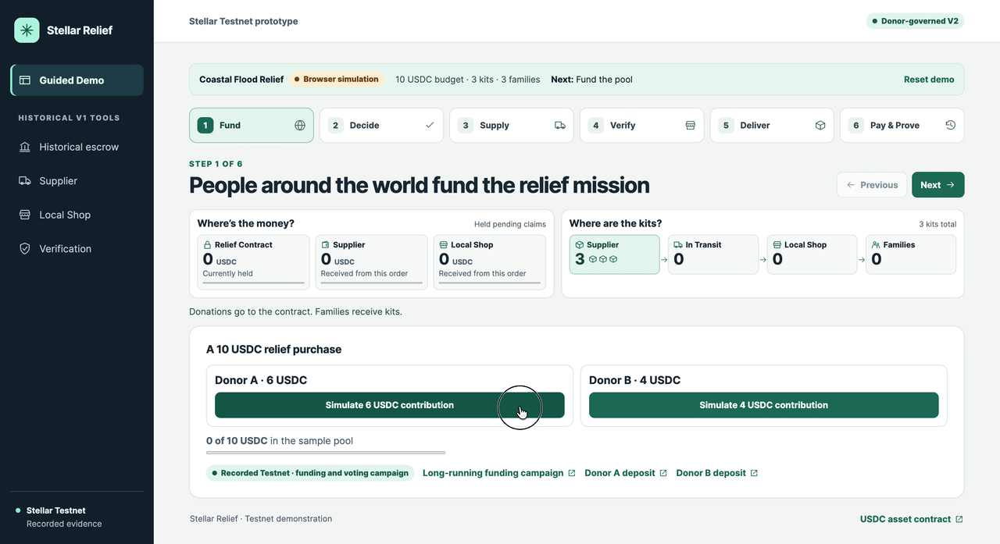

# Stellar Relief

Stellar Relief V2 is a disaster-relief procurement prototype that uses a Stellar smart contract to commit funds up front, let donors vote on orders, and protect payments earned by suppliers and local shops.



*The Guided Demo simulates the workflow in your browser without submitting Stellar transactions.*

[Open the public Guided Demo](https://stellar-relief-v2.vercel.app/) · [Run it locally](#run-the-competition-demo) · [Explore the V2 Testnet results](#v2-testnet-results)

## How it works

Emergency suppliers need confidence they will be paid before shipping. Donors need a way to see which relief order their money funded and when local partners were paid. The public ledger records the activity, and the contract enforces when committed funds become claimable payments or refundable balances.

1. Donors contribute USDC directly to a Soroban pool. Once the funding target is met, each donor address can vote once, with weight proportional to its contribution.
2. After the voting deadline, finalization approves a proposal only if it received more than half of the funded pool's voting weight. If no proposal wins, donors can claim their full contributions.
3. The supplier authorizes a dispatch declaration, and the shop authorizes a matching receipt. Accepted receipt lets the supplier claim its share.
4. The authorized issuer attests an aggregate distribution count. Full distribution lets the shop claim its share separately.

For a **10 USDC** pool, the funds are committed before shipment. Accepted receipt reserves **7 USDC** for the supplier. Full distribution attestation reserves the remaining **3 USDC** for the shop. If the deadline passes after accepted receipt without full distribution attestation, only the unearned **3 USDC** is refundable. The supplier can claim its earned **7 USDC** before or after expiry, regardless of refund timing. The 70/30 split is a prototype allocation. Market pricing and platform revenue are outside the scope of this example.

## V2 Testnet results

Three campaigns used the same separate-claims contract build and fictional orders funded with Testnet USDC.

| Scenario | Recorded outcome | Evidence |
| --- | --- | --- |
| A. Successful two-stage payment | From a 10 USDC pool, the supplier claimed 7 USDC after accepted receipt. The shop later claimed 3 USDC after full distribution attestation. The pool ended at zero and the campaign was `Settled`. | [Contract](https://stellar.expert/explorer/testnet/contract/CCQJYZFPUCKVA76AU3RDWIHPPNSZKSG45QNEZXE7V3QHPOSPKGJF2XNH) · [Supplier claim](https://stellar.expert/explorer/testnet/tx/ba3621b7bd9592274718ead7e5ce13874e849b2f24b529bd46644ec5262e1231) · [Shop claim](https://stellar.expert/explorer/testnet/tx/901f62794261f9c420f597849b71848a0314ca623ecbe3dd747f49ab796182b2) |
| B. Distribution timeout | Receipt was accepted, but distribution was never attested. Donors recovered only the unearned 3 USDC, split 1.8 and 1.2 USDC. The supplier still claimed its protected 7 USDC. | [Contract](https://stellar.expert/explorer/testnet/contract/CAXFQFAJYAPU54DCBR67LMVOJEPWGMK6OPO4UNFGPER46NKABL2WZ5RC) · [1.8 USDC refund](https://stellar.expert/explorer/testnet/tx/18433d735bc2a2c11ae2d4739da271a76959880ce6b3becdbf8402c621d1f089) · [1.2 USDC refund](https://stellar.expert/explorer/testnet/tx/6c352982419923c23de75743347e63b4941eb07c7990a2125bc6b42f4fedf560) · [Supplier claim after expiry](https://stellar.expert/explorer/testnet/tx/a74afdc4399c799f5b0477bed5949a6d769b8ee6b320dfadcb9cc84647d642cb) |
| C. No winning proposal | Voting expired without a winner. The donors recovered the full 10 USDC as refunds of 6 and 4 USDC. | [Contract](https://stellar.expert/explorer/testnet/contract/CCTQHJSLENZYPA2Q7XBVUGNVWMX4SMI7NSL577N4F34YTCIAERJ5PN5P) · [Finalization](https://stellar.expert/explorer/testnet/tx/5812775f173ac14a1ec91300902a6ec16e7fc5a859244962743843a7739ae5f5) · [6 USDC refund](https://stellar.expert/explorer/testnet/tx/166ffdca276b12184c3de7c39f6b3b3414eeaf864d34562a82c4303cdc10e489) · [4 USDC refund](https://stellar.expert/explorer/testnet/tx/c427a3c7e28658899aa84d46c0cbd54fc9dbf7f5d74ec2ebfeb716aa61dddb4f) |

In Scenario B, both donors were refunded first. The supplier could still claim its 7 USDC afterwards, because refunds only cover unearned funds. The order reflects the test sequence.

The [successful campaign report](docs/testnet-v2-separate-claims.md) and [exception campaign report](docs/testnet-v2-exception-paths.md) contain the full transaction histories, balance snapshots, and read-only checks for premature and duplicate operations. The campaigns used recycled test tokens and demo accounts.

## Architecture

| Component | Responsibility |
| --- | --- |
| [Rust/Soroban donor pool](contracts/donor_pool) | Holds the configured Stellar asset, records voting and signed fulfillment declarations, and enforces payment and refund rules. |
| [React, TypeScript and Vite demo](web) | Shows funding, votes, kit inventory and both payment milestones. The six-step Guided Demo stores its progress locally in the browser. |
| Service worker and browser storage | The production service worker caches the app for offline reopening after an online visit. Sample voucher redemptions persist and duplicate codes are rejected in the same browser. |
| [Evidence and contract notes](docs/donor-governed-v2.md) | Explain authorization, refund accounting, historical deployments and the revised API. |

Stellar provides a public transaction record and a Stellar Asset Contract for USDC transfers. Soroban makes role authorization and payout rules enforceable by the contract. No NGO wallet needs custody of the pool. Soroban authenticates the accounts that make the declarations. Independent processes are still needed to verify physical delivery and eligibility and to resolve disputes.

## Run the competition demo

Use Node.js 22.17 or later in the 22.x series. No wallet or environment variables are needed for the Guided Demo. From the repository root:

```sh
npm --prefix web ci
npm --prefix web run dev -- --host 127.0.0.1
```

Open the local URL printed by Vite and choose **Start new demo**. Fund 6 + 4 USDC, vote 6–4 for Coastal Flood Relief, and dispatch three kits. Confirm the shop receipt and simulate the 7 USDC supplier payment. Redeem the three vouchers, attest distribution and simulate the 3 USDC shop payment. **Pay & Prove** links to current and historical Testnet evidence. Browser actions do not submit transactions or move tokens.

To rehearse offline on localhost, build and serve the production app:

```sh
npm --prefix web run build
npm --prefix web run preview -- --host 127.0.0.1
```

Open the preview online and wait for **App cached for offline reopening** on **Deliver** before disconnecting. Voucher records stay in the current browser.

## Test locally

From the repository root, run the V2 contract tests and build with Rust, the `wasm32v1-none` target, and Stellar CLI 30.0.1:

```sh
cargo test --locked --manifest-path contracts/donor_pool/Cargo.toml
stellar contract build --locked --manifest-path contracts/donor_pool/Cargo.toml
```

After `npm --prefix web ci`, run the frontend tests. The unit suite uses Stellar CLI for local signing fixtures. Both offline and browser checks use the production build. The browser check needs Google Chrome (or a Chromium executable set through `CHROMIUM_PATH`) and permission to open a loopback port.

```sh
npm --prefix web test
npm --prefix web run build
npm --prefix web run test:offline
npm --prefix web run test:browser
```

For the historical V1 contract and Python tooling, run `cargo test --locked` and `python3 -B -m unittest -q` from the repository root. The Python suite uses Python 3 and Stellar CLI for signing fixtures.

## Limitations and future work

- The Guided Demo uses fictional orders and browser-local voucher records. Wallet-signed V2 frontend transactions, on-chain verification of individual voucher redemptions, and secure cross-device reconciliation are future work.
- The contract checks authorized declarations and aggregate counts. Those declarations cannot establish that goods were physically delivered, that households were eligible, or that each voucher was redeemed.
- Real-world supplier participation and commercial viability remain untested. Dispute handling and production custody and token controls need further work. The contract requires independent security review before production use.

## Earlier deployments and V1

The [earlier V2 Testnet runs](docs/donor-governed-v2.md#recorded-stellar-testnet-evidence) include an atomic settlement. The three campaigns above use the later V2 contract with separate claims.

The [V1 escrow prototype](docs/v1-legacy.md), [Testnet evidence](docs/testnet-evidence.md), and [signed delivery tooling](docs/verified-delivery.md) remain available. **Historical V1 tools** in the web sidebar opens the archived demo workspaces.
