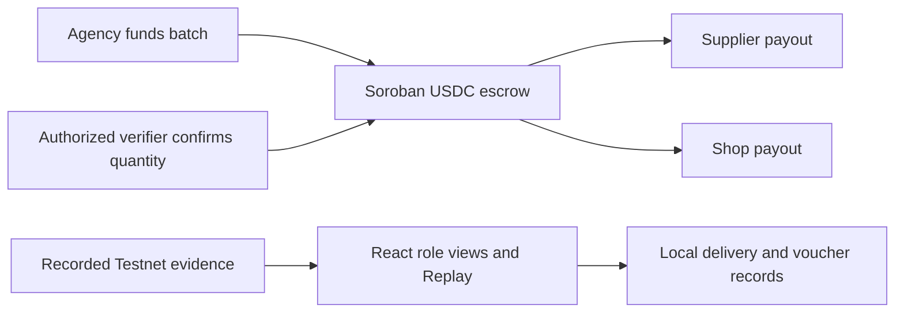

# Stellar Relief

## Donor-governed V2 fork

This public fork develops a second, donor-governed version. The original project remains at [Terry-DDL/stellar-relief](https://github.com/Terry-DDL/stellar-relief) and is not changed by this fork. The existing Testnet escrow demo and its evidence below are retained as the V1 reference.

**V2 goal:** donors send a Stellar asset directly to a smart contract pool rather than to an NGO wallet. Anyone may publish a relief-order proposal naming a region, supplier, shop, and quantity. Once the pool reaches its target, donors vote with weight equal to their contribution. A proposal needs more than half of the pooled amount to win. The selected order remains locked until the supplier declares dispatch, the shop independently declares receipt, and a separate voucher issuer attests the aggregate distribution. The contract then pays the supplier and shop 70/30. If the vote fails or the delivery deadline passes, donors can claim refunds.

The V2 contract is in [`contracts/donor_pool`](contracts/donor_pool). Its Rust tests cover successful settlement, failed-vote refunds, and missed-delivery refunds. The V2 page opens by default in the web app; its buttons are **browser-local simulations**, not signed contract calls. The old Guided Demo and its recorded Testnet transactions remain available through the sidebar. A donor cannot currently send USDC through the web app.

### V2 Stellar Testnet evidence

The [long-running campaign contract](https://stellar.expert/explorer/testnet/contract/CBYAGHNNIZ44E7AJQGCLTD3YMH57JFLTTA2Z3THVRO6NQB6HX4PNSC4X) has a 10 USDC target. Two Testnet donors [deposited 6 USDC](https://stellar.expert/explorer/testnet/tx/0e6d18fe321bbb6beca1465cabb51580fafbb8e5a5d4df31e915df13e23f2fda) and [4 USDC](https://stellar.expert/explorer/testnet/tx/8c4636705e16ca9c1d65894f96a09ff14ce1d70315c995271102f39b9a97b29a) directly. They [voted 6](https://stellar.expert/explorer/testnet/tx/e645550fa6ce0c8ffc74fca774a4e49d39a1479c3c56c9d80b5275924edf6ef6) for Coastal Flood Relief and [voted 4](https://stellar.expert/explorer/testnet/tx/4b4df4d12cb2880cd1c348802959cfb2671e6a9885a7d118f50311ea5c2ba3f5) for Mountain Landslide Relief. The vote deadline is November 16, 2026, so this instance cannot yet finalize.

A [second Testnet instance](https://stellar.expert/explorer/testnet/contract/CDLCJPEUKCNZFHHUGQI4C52KUVSRBMFX5CEQ4Y3XTX7T3WG2B4TO27ZK) uses a short demo deadline. It independently received [6 USDC](https://stellar.expert/explorer/testnet/tx/48a1229c1719c5867950379e18836b4828ad0efdaabdde576e7efd1bd1627c8c) and [4 USDC](https://stellar.expert/explorer/testnet/tx/4c7ce95768f08e7965cc63d693f705b13067daf7cb723d27ed26881525312218), then [recorded a 6-vote](https://stellar.expert/explorer/testnet/tx/04d28154c7e6cfaa087713dd93efd985d68926876e8db8a2c6205b4992e1901f) and [4-vote](https://stellar.expert/explorer/testnet/tx/e7280052bbaa863c853a4beeb2d37e9809753ba83bc10f8f279aeefa7414df35) split. Both instances use Circle's Testnet USDC asset contract. These are fictional relief orders and Testnet funds; no physical goods were shipped.

The short campaign [finalized the 6–4 vote](https://stellar.expert/explorer/testnet/tx/e31de132688372dcc91d7657216ce99a5ca06d82473629fb8b3a5c3d6f5c0aae). A supplier address [declared 3 kits dispatched](https://stellar.expert/explorer/testnet/tx/f17872955c55f488c0b5be75ab632fa5dd728cde1fc578d72e0927d5ed8c77d9), a separate shop address [declared 3 received](https://stellar.expert/explorer/testnet/tx/881ae6920559dec3c1da0c820ca6678cdd52fa48e1399450e2b73f76b45dbc6c), and an issuer address [attested 3 distributed](https://stellar.expert/explorer/testnet/tx/8028310be8d9fc92348674ccfd9e494c838de216ee6137db8e52f5f85575d719). The contract then [settled 7 USDC to the supplier and 3 USDC to the shop in one transaction](https://stellar.expert/explorer/testnet/tx/3be19fb3d887155d54c8db14ea82a05e28d1ad3333c5702cb008594c409327eb), returning `phase=Settled`. These are signed declarations by demo accounts, not independent physical-delivery proof or real voucher scans.

The voucher issuer is a relief actor, not a custodian of donated funds. The contract records only an aggregate count that this actor attests. It does not prove that each household is real or that goods physically arrived. QR scanning, household eligibility, cross-device reconciliation, independent audits, actual fiat on-ramps, and dispute adjudication remain unimplemented. The 70/30 split and two sample regions are demo parameters, not validated operating economics. Do not expose beneficiary identities on a public ledger.

Run the new contract tests with `cargo test --manifest-path contracts/donor_pool/Cargo.toml`; run the web app using the installation commands below. V1 contract commands elsewhere in this README refer to the preserved original prototype.

**Pre-funded Relief Supply with Offline Voucher Distribution**

## Project Overview

Stellar Relief is a humanitarian logistics prototype. An aid agency secures relief funds in a Stellar escrow before a supplier ships goods. The supplier can verify the committed funds. Families collect goods at a local shop using offline vouchers, and an authorized verifier can release the supplier payment and shop fee in a single USDC settlement.

## The Problem

Local suppliers can face delays between accepting a relief order and getting paid. The uncertainty can hold up shipments, while unreliable connectivity can interrupt voucher distribution and reconciliation.

## Our Solution

The agency funds the batch upfront and records who is authorized to verify it. A supplier can inspect the deposit before shipping. The shop can record aid collection during an outage and reconcile its records after reconnecting. The current contract enforces the payment terms. The browser demo illustrates the field operations.

## How It Works

1. The agency funds a batch and registers the supplier, shop, verifier, and payout amounts.
2. The supplier verifies the escrow and records a batch delivery in the demo. The shop independently enters and confirms the received quantity.
3. The shop records voucher redemptions up to the confirmed quantity, including offline after the production app is cached. After reconnecting, it can mark records reconciled locally.
4. The authorized verifier submits the quantity. Soroban atomically pays the supplier and shop and marks the batch settled.

For a 100 USDC relief batch, the intended split is 70 USDC for the supplier and 30 USDC for the shop. The recorded Testnet run used **10 USDC → 7 USDC + 3 USDC**.

## Why Stellar & Soroban?

Stellar gives agencies and suppliers a shared transaction record they can inspect independently. Soroban lets the contract enforce authorization and batch state and commit both payouts together. The Testnet run used USDC through its Stellar Asset Contract.

## Key Features

- USDC escrow with agency funding authorization, verifier-only settlement, quantity validation, and duplicate-settlement protection.
- Agency, Supplier, Local Shop, and Verification views.
- Separate supplier and shop actions with a batch-scoped audit timeline and redemption count.
- A production service worker caches the app for offline reopening after an initial online visit. The three paper vouchers support offline entry, reload persistence, duplicate rejection, and simulated reconciliation.
- Read-only Testnet lookup that compares live contract state with the recorded run.
- Historical Replay of the verified batch, with field operations labeled as simulations.

## System Architecture



The Python E2E runner manages Testnet transactions and checkpoints separately from the web app. The frontend reads a checked-in evidence snapshot and stores the delivery and voucher demo on the current browser.

## Demo Screenshots

Run the demo locally to explore the four role views.

## Stellar Testnet Deployment

| Field | Recorded value |
| --- | --- |
| Network | Stellar Testnet |
| Run ID | `f141f179b1d94e349421b48e0bfbafe6` |
| Contract | [`CCOZA3KQNXIYB3ERKKAYZ4NKWBHTZQFSIEQQS7HXEBGH3RULUXHJ7PMR`](https://stellar.expert/explorer/testnet/contract/CCOZA3KQNXIYB3ERKKAYZ4NKWBHTZQFSIEQQS7HXEBGH3RULUXHJ7PMR) |
| WASM SHA-256 | `4b763614f798027da3ed93126242ee947410cce3bfb563ccf107c7d0328bdeb8` |
| Batch | `1`, three kits, `Settled` |

## Real USDC Settlement Proof

The run recorded four transactions with RPC status `SUCCESS`.

| Transaction | Ledger | Stellar Explorer |
| --- | ---: | --- |
| Upload WASM | 5,688,193 | [Testnet transaction](https://stellar.expert/explorer/testnet/tx/55c1e7ff271d4cbc83811415c6e84278049f265d45304c9896c912e9cb6922b1) |
| Deploy contract | 5,688,194 | [Testnet transaction](https://stellar.expert/explorer/testnet/tx/65b77d82b6bcfeaeee2b1406741ddd5e347f7b585eaa40ad72a4300a6e2f6e24) |
| Fund 10 USDC | 5,688,196 | [Testnet transaction](https://stellar.expert/explorer/testnet/tx/dc5ee151a1ef632031d0e27c7629382e02e956067f894f2135ce0ac5bf5ed5ec) |
| Settle 7 USDC + 3 USDC | 5,688,199 | [Testnet transaction](https://stellar.expert/explorer/testnet/tx/0ae91cd2ba8aea76a0ab470dd08f844a9290111666ce6582918ce4522ff8dda4) |

| Balance in USDC | Agency | Escrow | Supplier | Shop |
| --- | ---: | ---: | ---: | ---: |
| Before funding | 10 | 0 | 0 | 0 |
| Funded | 0 | 10 | 0 | 0 |
| Settled | 0 | 0 | 7 | 3 |

Balances and batch status came from read-only RPC simulations. Wrong-verifier, wrong-quantity, and duplicate-settlement checks also ran as simulations. See the [curated evidence](docs/testnet-evidence.md) for transaction hashes, asset identifiers, and batch snapshots. Testnet history may become unavailable after a network reset.

## Installation & Local Development

Use Node.js 22.17 or later. From the repository root:

```sh
npm --prefix web ci
npm --prefix web run dev -- --host 127.0.0.1
```

Open the local URL printed by Vite. **Donor-governed V2** opens by default. Use the **Guided Demo** link for the preserved V1 Coastal Flood Relief campaign tied to Procurement Order #001 and the recorded Stellar Testnet batch. Its first step simulates contributions from donors using local currency through a provider or an existing USDC wallet. This browser-local donor pool is separate from the recorded Testnet escrow deposit; no fiat conversion or donor transaction occurs. The Agency, Supplier, Local Shop, and Verification views remain available in the navigation. Historical Replay is under **Agency**. The web demo requires no wallet or environment variables.

### 60-second guided demo

1. **0–10 s · Show the donor entry point.** Select a local payment currency and simulate a USDC contribution. Explain that a production integration would obtain an actual quote from an eligible provider and send USDC to a campaign wallet. The sample donor pool is local to this browser.
2. **10–30 s · Check before dispatch.** Show Order #001: the recorded 10 USDC escrow deposit is split into 7 USDC for the supplier and 3 USDC for the shop. Open **Review supplier proof**. Show the supplier address, verifier, and funding transaction. Select **Verify on Stellar Testnet** to check the live contract and batch fields. The recorded order has already settled, and the RPC check does not read the current escrow token balance.
3. **30–50 s · Demonstrate field operations.** Click **Run sample delivery demo** to record three kits, confirm receipt, and redeem one voucher on this browser. Click it again to show that the existing redemption is retained. The manual controls remain available for demonstrating a quantity mismatch or duplicate redemption.
4. **50–60 s · Show settlement.** Open the confirmed transaction that paid both recipients together. The browser demo actions have no effect on that transaction.

Use **Reset demo** in the delivery stage or Local Shop to clear this browser's field records before presenting again.

To try offline reopening, use the production build on HTTPS or localhost:

```sh
npm --prefix web run build
npm --prefix web run preview -- --host 127.0.0.1
```

Open the app online and wait for the delivery stage or **Local Shop** to report that it is cached. Then disconnect and reload. Reconnect to use **Verify on Stellar Testnet** in the supplier stage, **Supplier**, or **Verification**. If browser CORS blocks the request, run the same read-only check from the repository root:

```sh
node --disable-warning=ExperimentalWarning --experimental-strip-types web/scripts/verify-testnet.mjs
```

See the [evidence and offline technical notes](docs/evidence-offline.md) for the full walkthrough.

## Smart Contract Functions

| Function | Purpose |
| --- | --- |
| `__constructor(agency, asset)` | Stores the authorized funding account and token contract. |
| `fund_batch(...)` | Requires agency authorization, validates the quantity and payout split, and escrows funds while registering the batch. |
| `get_batch(batch_id)` | Returns the matching batch and its funding or settlement status. |
| `settle_batch(batch_id, verified_quantity)` | Requires the registered verifier and matching quantity. Pays both recipients and updates state atomically. |

## Testing & Verification

The local suite covers 16 Rust contract tests, 41 Python tests for the E2E and account tools, and frontend demo-state and evidence checks. Use Python 3.10+, Rust with `wasm32v1-none`, and Stellar CLI 30.0.1 for the full local workflow.

```sh
cargo test
CARGO_TARGET_DIR=target/usdc-build stellar contract build
python3 -B -m unittest -q
npm --prefix web run build
npm --prefix web test
npm --prefix web run test:offline
npm --prefix web run test:browser
```

The browser test requires Google Chrome and a loopback listener. The standard frontend evidence test uses the checked-in extract. If the original local report is present, compare it with the same JSON using `node web/scripts/evidence.mjs --original`. These commands run tests or build artifacts. The Python E2E runner is a separate tool that can submit Testnet transactions.

On November 12, 2026, the production build and real Chromium suite passed on a Mac. The suite verified that the service worker served the document, JavaScript, and CSS during offline reloads. It also covered voucher persistence, duplicate rejection, all four role views while offline, and a fresh HTTP response after reconnecting. A separate read-only Stellar RPC check at ledger `5689239` reported `Settled` with no mismatches.

## Security & Limitations

- This is a Testnet prototype with one batch per contract instance and a fixed quantity of three. It has no production audit.
- Replay reads historical evidence. Supplier delivery and shop receipt are unsigned demo records. Vouchers persist and reject duplicate codes within the same browser. Reconciliation is simulated. The contract verifies the signer and declared quantity. Physical delivery and voucher eligibility remain outside the contract.
- Offline reopening requires a successful initial online load of the production build. Clearing browser site data removes the cache and local records.
- The live RPC check requires network access. It compares ledger fields and does not sign or submit a transaction. Testnet resets or expired contract state can make live verification unavailable.
- The demo does not support global fiat on-ramps, real-world delivery verification, cross-device sync, or local fiat off-ramps.
- Keep signing identities, raw checkpoints, local run evidence, and environment files outside the public repository.

## Future Roadmap

Explore real delivery verification, cross-device offline reconciliation, fiat funding and payout integrations, and operational controls for multiple relief batches.

## Team / Hackathon

University of Waterloo Stellar Blockchain Innovation Challenge

## License

No license file is present. Contact the project authors before reusing or redistributing the code.
